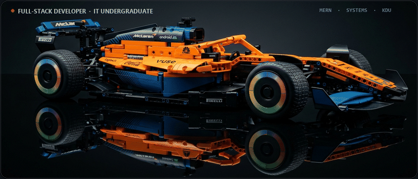
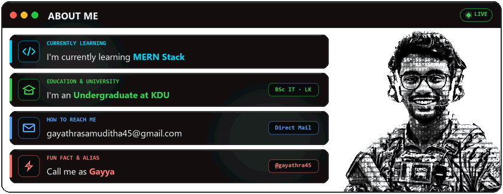
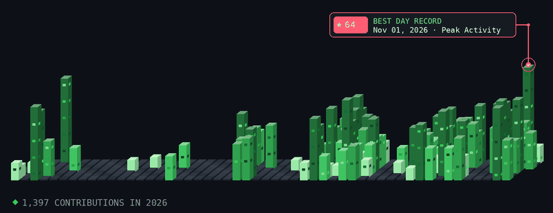

<!-- Minimalist Animated Header -->

  

<!-- About Me Section (Unified Terminal Card + Live ASCII Portrait) -->

  

<!-- GitHub Statistics -->
##  GitHub Statistics

<table align="center">
<tr border="none">
<td width="50%" align="center">
  
  
  
   
   
  
  
</td>

<td width="50%" align="center">

  

</td>
</tr>
</table>

<!-- Contribution Skyline (generated by .github/workflows/skyline.yml) -->

##  Technologies & Tools

  

##  Connect With Me

  
  
  
  
  

 

  

  
  

  © 2026 <b>Gayathra Samuditha (@gayathra45)</b> 

 

