<!-- Minimalist Animated Header -->

  

<!-- About Me Section (Unified Terminal Card + Live ASCII Portrait) -->

  

<!-- GitHub Statistics (Modern Bento-Grid Telemetry Dashboard) -->

  

<!-- Contribution Skyline (generated by .github/workflows/skyline.yml) -->

<!-- Technologies & Tools (Categorized Bento-Grid Architecture) -->

  

<!-- Connect With Me (Modern Dark-Glass Interactive Social Buttons) -->

  
  

    &nbsp;&nbsp;&nbsp;&nbsp;&nbsp;&nbsp;&nbsp;&nbsp;
  

<!-- Bento Telemetry Dock Footer & Redesigned Profile Views -->

  

